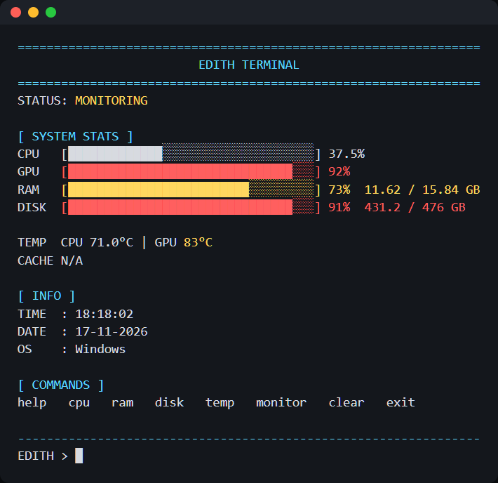

# EDITH

A terminal dashboard for CPU, GPU, memory, disk, and temperature readings.

[](https://github.com/harsh4k/edith/actions/workflows/ci.yml)
[](pyproject.toml)
[](LICENSE)



The screenshot shows sample values.

## Features

- Usage bars for CPU, GPU, RAM, and disk. Usage turns yellow at 70% and red at 90%.
- Temperature readings turn yellow at 80 °C and red at 90 °C.
- A width-aware dashboard with a frame between 40 and 64 columns.
- Colour is disabled when `NO_COLOR` is non-empty or stdout is not a TTY.
- Bars use `#` and `-` when the output encoding cannot display the Unicode bar characters.
- GPU load and temperature come from the first NVIDIA GPU via `nvidia-smi`.
  Unavailable readings show `N/A`.
- CPU temperature uses `psutil` sensors, usually available on Linux.
  Windows and macOS show `N/A` for CPU temperature.
- Memory cache readings on Linux; `N/A` when unavailable.

## Install

Use Python 3.10 or newer. Installing directly from GitHub also requires Git.

```sh
pip install git+https://github.com/harsh4k/edith
edith
```

Or install from a clone:

```sh
git clone https://github.com/harsh4k/edith.git
cd edith
pip install -e .
python edith.py
```

## Usage

Type a command at the `EDITH >` prompt and press Enter.

| Command | Meaning |
| --- | --- |
| `help` | List the available commands. |
| `cpu` | Show CPU usage as a percentage. |
| `ram` | Show used and total RAM in GB. |
| `disk` | Show used and total disk space for `/` in GB. |
| `temp` | Show CPU and GPU temperatures, or `N/A` when unavailable. |
| `monitor` | Refresh the dashboard every 2 seconds until a key is pressed. |
| `clear` | Clear the screen and redraw the dashboard with current readings. |
| `exit` | Shut down EDITH. |

In monitor mode, any key stops monitoring and returns to the command prompt.
If the console does not support single-key input, press Enter to stop.
Ctrl+C exits at the command prompt; during monitoring, it stops monitoring and
returns to the prompt. Memory and disk values use 1024³ bytes per displayed GB.

## Development

From the repository directory:

```sh
pip install -e ".[dev]"
ruff check .
ruff format --check .
pytest
```

CI runs these lint, format, and test checks on Ubuntu, Windows, and macOS with
Python 3.10 and 3.13. Tests mock hardware readings.

See [CLAUDE.md](CLAUDE.md) for project conventions.

## Licence

EDITH is available under the [MIT licence](LICENSE).
